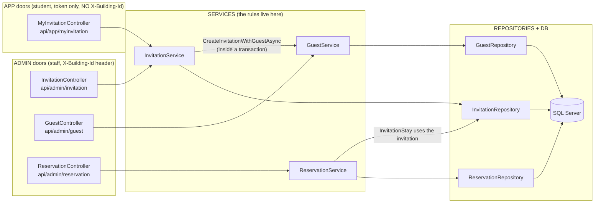
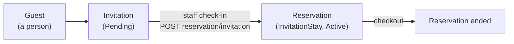
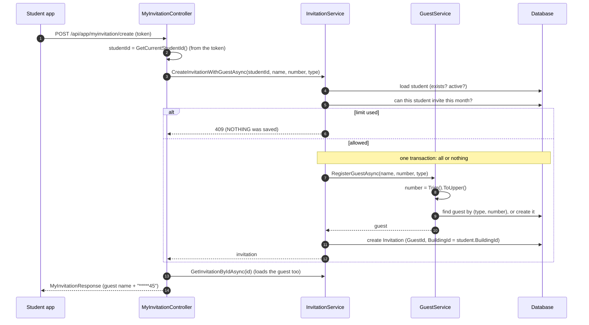

# Guests, invitations and reservations: the map

> Idea: controllers are **doors**, services are the **rooms** behind them.
> The app door and the admin door open into the **same rooms**.
> The door knows who is calling and what to return. The room knows the rules.

## 1. The big map

## 2. Three things, three jobs

| Thing | What it is | Scope | Example |
|---|---|---|---|
| **Guest** | A person. One row per document. | Global (no building) | John, Passport AB1234545 |
| **Invitation** | "Student X invites guest Y" | Building (from the student) | Anna invites John, May |
| **Reservation** | The real stay: room, dates, payment | Building | John stays in room 101 |

## 3. Student creates an invitation (the whole story)

## 4. Who calls what

| Door (endpoint) | Calls | Notes |
|---|---|---|
| APP `GET  myinvitation` | `InvitationService.GetInvitationsAsync(studentId)` | only his own invitations |
| APP `GET  myinvitation/can-invite` | `CanStudentInviteThisMonthAsync(studentId)` | |
| APP `POST myinvitation/create` | `CreateInvitationWithGuestAsync(...)` | limit check, then guest + invitation in one transaction |
| ADMIN `GET  invitation/get-all`, `{id}` | `GetInvitationsAsync`, `GetInvitationByIdAsync` | filtered by the building header |
| ADMIN `GET  invitation/can-invite/{studentId}` | `CanStudentInviteThisMonthAsync` | |
| ADMIN `POST invitation/create` | `CreateInvitationAsync(studentId, guestId)` | the guest must already exist |
| ADMIN `DELETE invitation/delete/{id}` | `DeleteInvitationAsync` | |
| ADMIN `POST guest/create` | `GuestService.RegisterGuestAsync` | no student, no limit |
| ADMIN `PUT guest/update/{id}` | `GuestService.UpdateGuestAsync` | computes the final (type, number) pair first |
| ADMIN `POST reservation/invitation` | `ReservationService.CreateInvitationReservationAsync` | invitation must be Pending |

## 5. Rules (change them in ONE place only)

1. **A guest is identified by the pair (DocumentType, DocumentNumber).** Unique index in the DbContext.
2. The number is cleaned (`Trim().ToUpperInvariant()`) in `GuestService`, before every lookup and save.
3. **1 invitation per student per month.** Checked in `InvitationService` **before** a guest is created.
4. `RegisterGuestAsync` does NOT know about students. The admin uses it too, and has no student.
5. The guest has no `BuildingId`. The invitation gets `BuildingId` from `student.BuildingId`.
6. The student app sends no `X-Building-Id`. Never use `[RequireBuilding]` on `api/app`.
7. The student response is masked. The full document number is for staff only.

## 6. When you are lost

1. Which **door** is it? (app or admin)
2. Which **service method** does the door call?
3. Which **rule** is broken? Find the rule in section 5, and fix it in its one place.
4. Does the change touch two tables? Then it needs `ExecuteInTransactionAsync`.

## 7. Before adding a feature (4 lines, in words)

1. Who calls it (door)?
2. Which checks come first?
3. Which saves must succeed together?
4. What does the door return?
